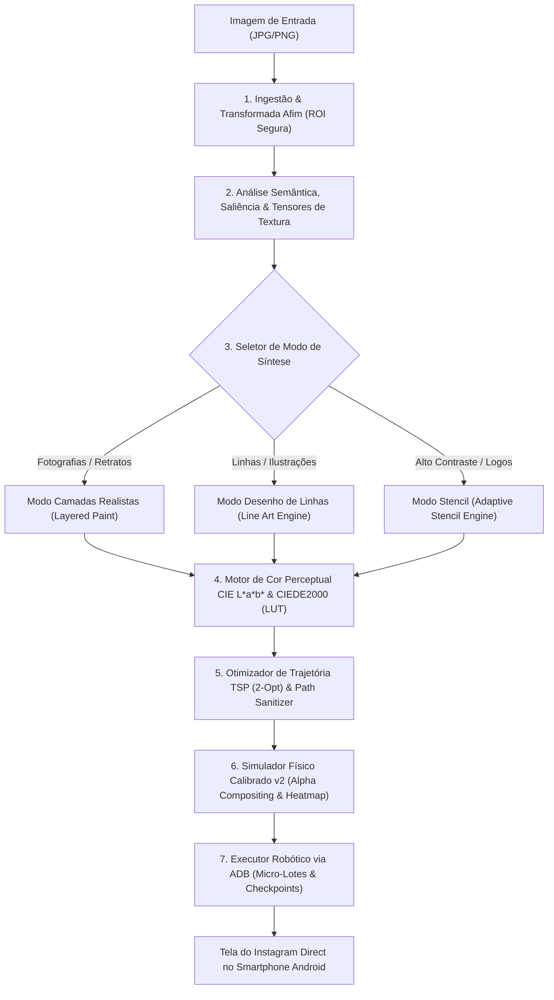
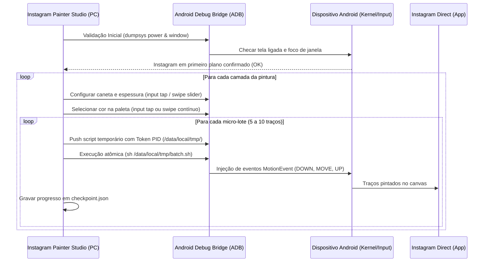

# Documentação Técnica Arquitetural: Instagram Painter Studio

> **Versão:** 3.2 (Mecanismo Perceptual, Determinístico e Resiliente a Falhas)  
> **Público-Alvo:** Engenheiros de Software, Pesquisadores de Visão Computacional, Desenvolvedores de Automação Robótica e Sistemas Embarcados.

---

## 1. O que o Projeto Busca Fazer (Objetivo e Escopo)

O **Instagram Painter Studio** é um sistema autônomo de pintura robótica de ultra-alta fidelidade projetado para reproduzir qualquer imagem digital (fotografias realistas, retratos com gradientes de pele, ilustrações de linhas/mangá, logos e stencils) diretamente dentro do módulo de desenho à mão livre do **Instagram Direct (Instagram Doodles)** em smartphones Android.

### 1.1 O Desafio Técnico
1. **Ausência de API de Desenho:** O Instagram não disponibiliza nenhuma interface programática para submeter imagens ao chat como traços nativos; toda interação precisa ocorrer simulando a ponta do dedo humano através da injeção de eventos de toque no kernel do Android.
2. **Restrições Extremas de Interface:** A interface do Instagram Direct possui uma paleta visível limitada (apenas 8 cores base na primeira página), um seletor de espectro contínuo oculto sob gesto de toque longo, um controle analógico de espessura na lateral esquerda e botões destrutivos extremamente próximos da área útil de desenho (botão 'X' de cancelar e aviãozinho de envio).
3. **Fidelidade Visual e Estética:** Uma simples vetorização ou conversão preto-e-branco resulta em borrões incompreensíveis ou traços duplicados. O sistema precisa entender a semântica da imagem (onde estão os olhos, bordas de alto contraste, reflexos de luz, direção do fluxo das texturas) e planejar uma sequência ordenada de pintura respeitando o comportamento físico dos pincéis.
4. **Resiliência e Segurança em Hardware Real:** Falhas de rede, oscilações de latência do ADB, chamadas telefônicas recebidas ou toques fora da área segura podem destruir horas de pintura. O sistema deve operar sob arquitetura *Fail-Closed* e persistência atômica.

---

## 2. Visão Geral da Arquitetura do Sistema

O fluxo de dados do Instagram Painter Studio é dividido em 7 subsistemas modulares sequenciais:



---

## 3. Detalhamento Técnico das Etapas e Algoritmos

### Etapa 1: Ingestão de Imagem, Geometria e Transformadas Afins
- **Mapeamento de Coordenadas:** O sistema trabalha com duas dimensões de coordenadas desacopladas:
  1. **Coordenadas Locais do Canvas ($x_c, y_c$):** Espaço normalizado $[0, W_{\text{canvas}}] \times [0, H_{\text{canvas}}]$ onde o algoritmo de visão computacional sintetiza os traços.
  2. **Coordenadas Globais da Tela do Celular ($x_s, y_s$):** Pixels físicos do dispositivo (ex.: $1080 \times 2400$ no Samsung Galaxy A73 5G).
- **Transformada Afim Rígida:** Uma matriz afim $M$ calcula a conversão biunívoca:
  $$\begin{bmatrix} x_s \\ y_s \\ 1 \end{bmatrix} = \begin{bmatrix} s & 0 & t_x \\ 0 & s & t_y \\ 0 & 0 & 1 \end{bmatrix} \begin{bmatrix} x_c \\ y_c \\ 1 \end{bmatrix}$$
  Garantindo preservação estrita de proporção (*aspect ratio*), centralização exata na área de desenho e enquadramento dentro dos limites seguros (`safe_bounds`) ou da ROI desenhada manualmente pelo usuário sobre o print da tela do celular.

---

### Etapa 2: Análise Semântica, Preservação Especular e Tensores de Estrutura
Antes de qualquer simplificação de cores, a imagem bruta em RGB passa por três extratores de visão computacional:
1. **Mapa de Saliência Visual por Resíduo Espectral (`SaliencyEngine`):**
   - Calcula a Transformada Rápida de Fourier (FFT 2D) da imagem.
   - Extrai o espectro de amplitude e de fase.
   - Subtrai o espectro de amplitude médio (resíduo espectral) e reconverte via IFFT para obter o mapa de probabilidade de atenção visual humana. Regiões críticas (olhos, nariz, boca, contornos principais) recebem peso prioritário de conservação.
2. **Preservação de Reflexos Especulares (`SemanticFeatureExtractor`):**
   - Retratos e olhos contêm reflexos de luz (*catchlights*) de alta luminosidade em áreas minúsculas ($< 10 \text{ px}$).
   - O algoritmo extrai uma máscara binária dessas altas luzes e a protege explicitamente contra operações morfológicas posteriores, impedindo que camadas escuras ou tons de pele soterrem o brilho dos olhos.
3. **Tensores de Estrutura de Textura (`TextureTensorEngine`):**
   - Para orientar o sentido físico das pinceladas ao longo das curvas orgânicas da imagem, calcula o Tensor de Gradiente Local:
     $$J = \begin{bmatrix} I_x^2 & I_x I_y \\ I_x I_y & I_y^2 \end{bmatrix}$$
   - Aplica suavização gaussiana ($K_\sigma * J$) e decompõe nos autovalores ($\lambda_1, \lambda_2$) e autovetores. O autovetor correspondente ao menor autovalor define a direção do fluxo tangencial e o grau de coerência da textura local.

---

### Etapa 3: Modos de Reprodução Especializados

#### 3.1 Modo Fotografias e Retratos Realistas (`LayeredPaintEngine`)
- **Quantização Perceptual Adaptativa:** Agrupa os pixels da imagem em $K$ centros de cor através de K-Means no espaço CIE L\*a\*b\* ponderado pela saliência visual.
- **Proteção Anatômica de Bordas:** Antes da limpeza morfológica de pequenos ruídos (*Morphological Open/Close*), os traços coincidentes com o mapa de bordas Canny e alta saliência são mascarados e restaurados integralmente.
- **Estratégias de Preenchimento de Região (`FillStrategyEngine`):**
  - *Horizontal Scanline:* Preenchimento em serpentina bidirecional (*boustrophedon*), alternando varredura esquerda $\to$ direita e direita $\to$ esquerda para minimizar elevação da caneta.
  - *Angled Hatching:* Hachura linear orientada pelo ângulo dominante extraído do tensor de estrutura da região.
  - *Chiaroscuro Cross:* Hachura cruzada densa em duas orientações para sombreamentos e áreas de alto contraste dramático.
  - *Edge-Aware Fill:* Preenchimento com anéis concêntricos a partir das bordas da região.
- **Espaçamento Calibrado sem Frestas:** O passo de deslocamento entre linhas consecutivas de preenchimento é calculado estritamente como:
  $$\text{spacing} = \max\left(1, \text{round}\left(\text{brush\_width} \times 0.65\right)\right)$$
  Garantindo sobreposição de 35% entre passagens adjacentes, eliminando fendas vazias na tela do celular.
- **Algoritmo do Pintor com Ordenação Topológica (`LayerGraphEngine`):**
  - As regiões coloridas são organizadas em um Grafo Dirigido Acíclico (DAG) baseado em dependências espaciais e luminosidade $L^*$.
  - Fundos e massas escuras são depositadas primeiro; tons médios, transições, bordas estruturais e, finalmente, reflexos especulares puros são pintados por cima.
- **Hierarquia de Bordas e Detalhes Originais:**
  - *Adaptive Edge Hierarchy:* Bordas finas são traçadas com caneta de espessura mínima (`min`), preservando contornos anatômicos.
  - *Colored Detail Layer:* Cada micro-traço de detalhe preserva sua cor de origem mapeada na paleta, sem converter linhas pretas ou escuras em traços brancos.

#### 3.2 Modo Desenho de Linhas e Ilustrações (`LineArtEngine`)
- **Binarização e Esqueletização Pura:** Aplica o algoritmo de esqueleto morfológico (Zhang-Suen / Lee-Kashyap), reduzindo qualquer traço de caneta ou contorno a uma linha central matemática de 1 pixel de espessura.
- **Rastreamento de Curvas Contínuas:** Monta um grafo topológico de nós e arestas a partir do esqueleto e percorre os caminhos mais longos possíveis, eliminando contornos externos duplicados.
- **Interpolação por Splines Cúbicas (`SplineInterpolator`):** Suaviza os vértices brutos através de B-Splines cúbicas uniformes, gerando traços curvilíneos naturais de caligrafia humana.
- **Tratamento Físico de Fundo:** Compara a cor do fundo original da imagem com o fundo escuro padrão do Instagram (`#161616`). Se houver divergência significativa ($\Delta E > 35$), sintetiza uma camada de base completa para receber o desenho.

#### 3.3 Modo Stencil de Alto Contraste (`AdaptiveStencilExtractor`)
- Aplica binarização mista Otsu + Sauvola local com suavização bilateral, gerando artes em alto contraste otimizadas para execução ultra-rápida (1 a 2 minutos).

---

### Etapa 4: Motor de Cores Perceptual CIE L\*a\*b\* & CIEDE2000

#### 4.1 Limitações do RGB e a Necessidade do CIE L\*a\*b\*
O espaço RGB é matematicamente cúbico e não linear perceptualmente: duas cores com a mesma distância euclidiana em RGB podem parecer quase idênticas ou totalmente divergentes para a visão humana.
O sistema converte todas as cores para o espaço **CIE L\*a\*b\*** (Luminosidade $L^*$, eixo Verde-Vermelho $a^*$, eixo Azul-Amarelo $b^*$).

#### 4.2 Distância Perceptual Estrita CIEDE2000 (ISO/CIE 11664-6:2014)
A correspondência entre a cor teórica da imagem e a cor física disponível no Instagram utiliza a fórmula completa de **CIEDE2000**:
$$\Delta E_{00} = \sqrt{\left(\frac{\Delta L'}{k_L S_L}\right)^2 + \left(\frac{\Delta C'}{k_C S_C}\right)^2 + \left(\frac{\Delta H'}{k_H S_H}\right)^2 + R_T \left(\frac{\Delta C'}{k_C S_C}\right) \left(\frac{\Delta H'}{k_H S_H}\right)}$$
Onde são computados:
- Fator de correção de croma $G$ e correção do croma $a'$.
- Termos de peso variáveis $S_L, S_C, S_H$ baseados na média local.
- Termo de rotação elíptica $R_T$ que compensa a não-linearidade visual no quadrante azul ($275^\circ$).

#### 4.3 Look-Up Table (LUT) 2D e Aceleração Espacial
- As coordenadas físicas de toque do Instagram são catalogadas no arquivo `color_lut.json`.
- Para busca instantânea durante quantização de milhões de pixels, uma árvore espacial **`scipy.spatial.cKDTree`** compilada em C é construída sobre os vetores $Lab$.
- **Heurística de Priorização da Paleta Nativa:**
  - O Instagram possui 8 cores nativas de toque direto (`input tap x y`) no rodapé: Branco, Azul, Verde, Amarelo, Laranja, Vermelho, Rosa e Roxo.
  - Para evitar o uso desnecessário de toques longos e arrastos de espectro contínuo que aumentam o tempo de desenho e o risco de oscilação gestual, se uma cor tiver proximidade perceptual aceitável ($\Delta E \le 6.0$) com uma cor base nativa, o sistema seleciona o toque direto da paleta base.

---

### Etapa 5: Otimização de Trajetória e Traços (Stroke Planning)

#### 5.1 Redução do TSP via Algoritmo 2-Opt (`StrokeSchedulerV2`)
Cada elevação do dedo virtual do robô e deslocamento no ar até o início do próximo traço consome tempo e desgasta o buffer de eventos.
O sequenciamento de traços dentro de cada camada é modelado como uma variante do **Problema do Caixeiro Viajante (TSP)**:
1. **Construção Gulosa:** Começa pelo traço mais próximo do canto superior esquerdo e encadeia o traço mais próximo da ponta final do anterior. Permite inversão de direção do traço ($P_0 \leftrightarrow P_{\text{last}}$) se a distância for menor.
2. **Refinamento Local 2-Opt:** Percorre iterativamente pares de arestas aéreas $(i, i+1)$ e $(j, j+1)$. Se inverter o segmento intermediário reduzir a distância total de percurso no ar, o segmento é invertido:
   $$\text{dist}(A, B) + \text{dist}(C, D) > \text{dist}(A, C) + \text{dist}(B, D)$$
   Esta etapa reduz o tempo total de deslocamento no ar em até **60%**.

#### 5.2 Sanitização e Segurança de Coordenadas (`PathSanitizer`)
- **Clamp de Limite Rígido:** Todo e qualquer ponto $(x, y)$ é estritamente limitado ao intervalo $[x_{\min}, x_{\max}] \times [y_{\min}, y_{\max}]$.
- **Deduplicação e Simplificação RDP:** Pontos repetidos consecutivos são removidos. Aplica simplificação Ramer-Douglas-Peucker com tolerância $\epsilon = 0.8 \text{ px}$ para eliminar micro-ruídos colineares.
- **Dinâmica Caligráfica (*Stroke Tapering*):** Se um traço contém mais de 4 vértices, pontos de atenuação suave são injetados no início e no término para simular o pouso e decolagem física da caneta.

---

### Etapa 6: Simulação Física Calibrada em Tempo Real (`CalibratedSimulatorV2`)

O simulador gráfico reproduz na tela do computador exatamente o que o aplicativo do celular irá renderizar:
- **Largura Física de Traço:** Mapeada via calibração de hardware (`brushes.json`) para cada ferramenta (`solid`, `marker`, `neon`) e nível de espessura (`min`, `med`, `thick`).
- **Modelo de Acúmulo Incremental (Marker):** O marcador do Instagram Direct é translúcido. O simulador implementa modelo de mistura alfa cumulativa por passagem:
  $$C_{\text{acum}} = \alpha \cdot C_{\text{pincel}} + (1 - \alpha) \cdot C_{\text{anterior}}$$
- **Mapa de Calor de Erro Perceptual (Heatmap):** Compara a imagem de entrada com a simulação física calculando:
  - **Mean $\Delta E_{00}$:** Erro perceptual médio em toda a área visível.
  - **P95 $\Delta E_{00}$:** Erro no percentil 95 (mede as maiores aberrações locais).
  - **SSIM (Structural Similarity Index Measure):** Similaridade estrutural e retenção de luminância e contraste.

---

### Etapa 7: Automação Robótica via ADB e Arquitetura Fail-Closed



#### 7.1 Protocolo de Injeção de Toque
- **Toque Simples na Paleta Base:** `input tap <x> <y>` (instantâneo e à prova de falhas).
- **Toque no Espectro Contínuo:** Executado via comando atômico de arrasto:
  `input swipe <bx> <by> <tx> <ty> 700`
  O comando envia `ACTION_DOWN` nas coordenadas base $(\text{bx}, \text{by})$, mantém a pressão por 700 ms (tempo necessário para o Instagram abrir o popup do gradiente) e interpola o arrasto suave até as coordenadas alvo $(\text{tx}, \text{ty})$, liberando com `ACTION_UP`.
- **Injeção de Pinceladas em Micro-Lotes:**
  - Os traços são agrupados em lotes de 5 a 10 pinceladas.
  - Um script de shell é gerado com os eventos encadeados:
    ```sh
    #!/bin/sh
    # TOKEN: ig_painter_a1b2c3d4
    echo $$ > /data/local/tmp/ig_painter_a1b2c3d4.pid
    input motionevent DOWN x0 y0
    input motionevent MOVE x1 y1
    input motionevent UP x2 y2
    rm -f /data/local/tmp/ig_painter_a1b2c3d4.pid
    ```
  - Isso garante velocidade máxima sem o overhead de criar uma conexão ADB para cada vértice.

#### 7.2 Princípio Fail-Closed e Tolerância a Falhas
1. **Validação Contínua de Segurança:** Antes de cada lote, o sistema consulta:
   - `dumpsys power` $\to$ Tela deve estar obrigatoriamente ligada (`state=ON` e `awake`).
   - `dumpsys window` $\to$ A janela em primeiro plano deve conter obrigatoriamente `com.instagram.android`.
   - Se o usuário receber uma notificação invasiva, sair do app ou desligar a tela, a execução é **pausada imediatamente**.
2. **Checkpoint Atômico em Disco (`checkpoint.json`):**
   - A cada micro-lote concluído, o hash do plano, índice da camada e índice do traço são salvos em disco.
   - Em caso de desconexão do cabo USB ou instabilidade do Wi-Fi, o botão "Retomar Pintura" recarrega o estado exato e continua sem repintar áreas já concluídas.
3. **Kill Switch por Process-Specific PID:**
   - Se o usuário clicar em "PARAR / EMERGÊNCIA", o sistema obtém o PID gravado em `/data/local/tmp/*.pid` e mata especificamente aquele processo (`kill -9 <pid>`), enviando em seguida uma tecla `KEYCODE_BACK` neutra para cancelar toques residuais.

---

## 4. Tecnologias, Bibliotecas e Ferramentas Empregada

| Componente / Biblioteca | Versão / Padrão | Papel na Arquitetura | Justificativa Técnica |
| :--- | :--- | :--- | :--- |
| **Python** | 3.10+ (testado 3.13) | Linguagem Base | Alta produtividade, ecossistema científico maduro e binding nativo com C/C++. |
| **OpenCV (`cv2`)** | 4.x | Processamento de Imagem | Filtros morfológicos, detecção de bordas Canny, transformações afins e conversão de espaços de cor em tempo real. |
| **NumPy** | 1.24+ | Computação Vetorial | Operações de matrizes de alta performance, manipulação de canais e máscaras binárias. |
| **SciPy (`cKDTree`)** | 1.10+ | Indexação Espacial | Busca de vizinho mais próximo em $O(\log N)$ para correspondência perceptual de cores em microsegundos. |
| **scikit-image** | 0.20+ | Análise Estrutural | Cálculo de SSIM estrutural e suporte a algoritmos avançados de segmentação. |
| **CustomTkinter (`ctk`)** | 5.2+ | Interface Gráfica (GUI) | Design moderno em modo escuro nativo, alta fluidez com suporte a threads e DPI scaling. |
| **Pillow (`PIL`)** | 10.x | Integração GUI-Imagem | Conversão de arrays NumPy/OpenCV para objetos visuais compatíveis com o Tkinter Canvas. |
| **Android Debug Bridge (ADB)** | SDK Platform-Tools | Ponte de Comunicação | Injeção de eventos de toque e controle do sistema operacional Android sem necessidade de root. |
| **Linux Shell Scripting** | POSIX sh | Execução Embarcada | Scripts em `/data/local/tmp` para injeção atômica de lotes de eventos com latência mínima. |

---

## 5. Estrutura de Diretórios do Projeto

```
Instagram_Painter_Project/
├── main.py                          # Ponto de entrada do executável e inicializador do Studio
├── config.py                        # Parâmetros globais, limites e coordenadas de interface
├── profiles/                        # Perfis de hardware de dispositivos suportados
│   └── SM-A736B/                    # Perfil oficial: Samsung Galaxy A73 5G
│       ├── brushes.json             # Calibração física de espessuras e suavidade de borda
│       ├── color_lut.json           # Look-Up Table com 334 amostras de cores reais
│       ├── device.json              # Dimensões de tela e metadados de hardware
│       ├── opacity.json             # Tabelas de opacidade alfa por passagem
│       └── ui_geometry.json         # Âncoras espaciais da interface do Instagram Direct
├── studio/                          # Núcleo de lógica do Instagram Painter Studio
│   ├── adb_manager.py               # Gerenciador de conexão, injeção de toques e resiliência
│   ├── app_gui.py                   # Interface Gráfica moderna em CustomTkinter
│   ├── execution_worker.py          # Thread de execução autônoma em micro-lotes com checkpoint
│   ├── painter_engine.py            # Orquestrador central de síntese de planos de pintura
│   ├── device/
│   │   ├── hardware_calibration.py  # Carregador e escalonador de geometrias de perfil
│   │   └── safe_executor.py         # Gerenciador de checkpoints em disco e tokens de PID
│   ├── planning/
│   │   ├── fill_strategy_engine.py  # Estratégias de preenchimento (Scanline, Hatching, Chiaroscuro)
│   │   ├── layer_graph_engine.py    # Grafo de ordenação de camadas (Painter's Algorithm)
│   │   ├── line_art_engine.py       # Motor de esqueletização, linhas centrais e curvas Spline
│   │   ├── path_sanitizer.py        # Sanitização estrita de limites, deduplicação e RDP
│   │   ├── spline_interpolator.py   # Suavização B-Spline de traços curvos
│   │   └── stroke_scheduler_v2.py   # Otimizador TSP 2-Opt para redução de saltos aéreos
│   ├── simulation/
│   │   └── simulator_v2.py          # Simulador determinístico com modelo de opacidade real
│   └── vision/
│       ├── adaptive_stencil.py      # Binarização adaptativa para artes em stencil
│       ├── error_map_engine.py      # Gerador de mapas de calor de erro (Delta E, SSIM)
│       ├── perceptual_color.py      # Motor CIEDE2000 e busca adaptativa na LUT via cKDTree
│       ├── saliency_engine.py       # Detector de saliência visual por resíduo espectral
│       ├── semantic_features.py     # Preservação de brilho nos olhos e detalhes coloridos
│       └── texture_tensor_engine.py # Extração de tensores de estrutura e fluxo de texturas
└── tests/                           # Suíte abrangente de testes automatizados e regressão
```

---

## 6. Resumo do Ciclo de Vida da Pintura

1. **Seleção da Imagem:** O usuário escolhe uma foto ou desenho no Studio.
2. **Calibração de ROI:** O usuário escolhe entre o enquadramento padrão seguro ou desenha um retângulo livre sobre a captura de tela ao vivo do celular.
3. **Síntese e Simulação:** O motor analisa os detalhes semânticos, mapeia as cores para a paleta real do Instagram, otimiza o trajeto e gera a pré-visualização completa em milissegundos com relatório de erro perceptual ($\Delta E$ e SSIM).
4. **Customização de Cores:** O usuário pode clicar em qualquer cor no Inspetor de Paleta para trocá-la em tempo real; a simulação é re-renderizada instantaneamente.
5. **Pintura Autônoma no Celular:** Com o Instagram aberto na tela de desenho, o robô assume o controle: configura espessura, seleciona as cores exatas na paleta do Instagram e injeta os milhares de traços com perfeição milimétrica até a conclusão da obra.
