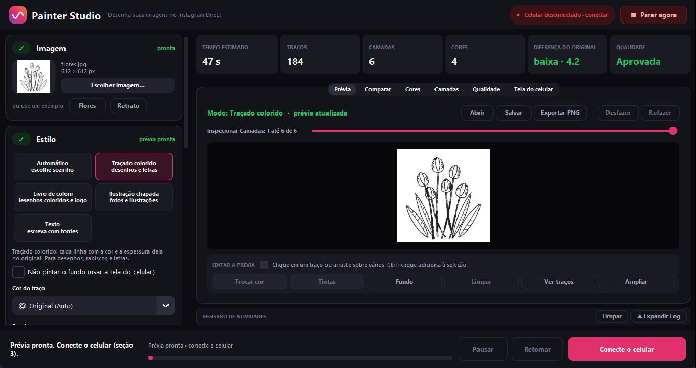
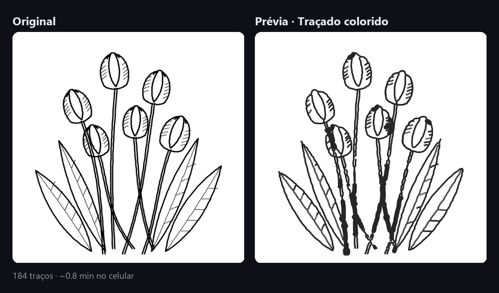
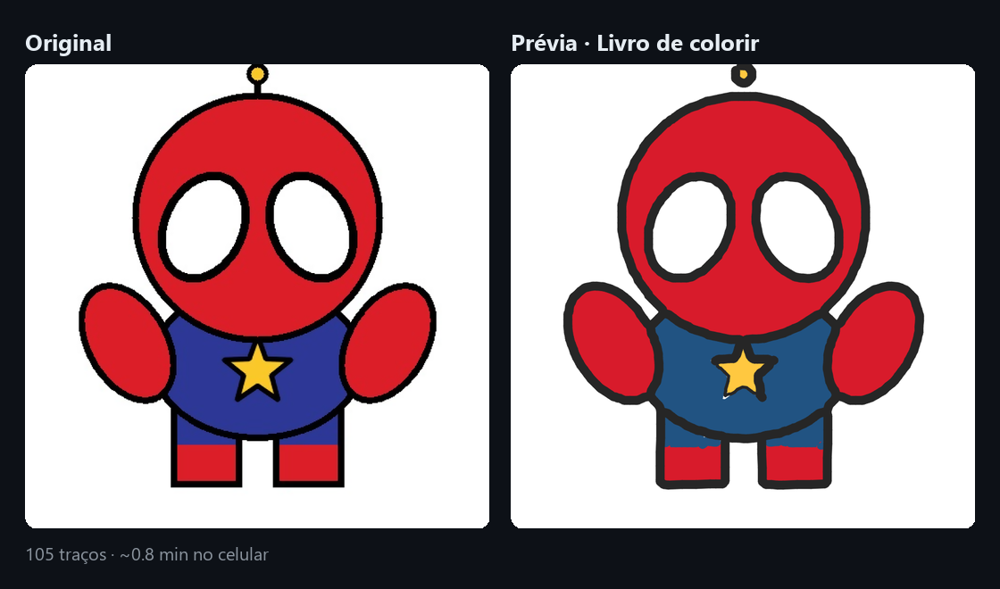
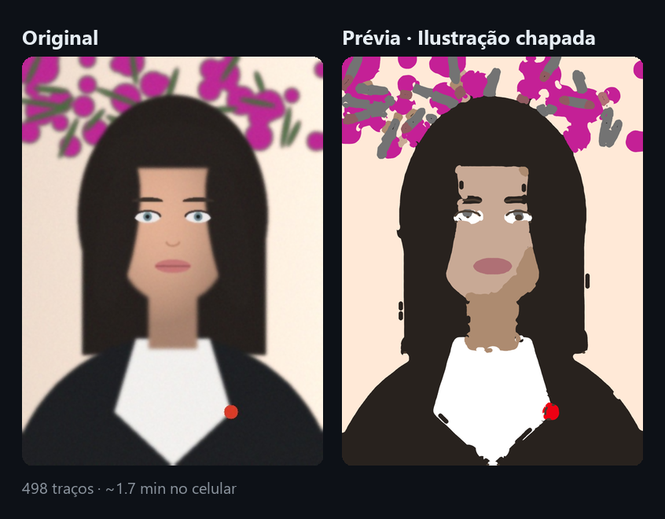
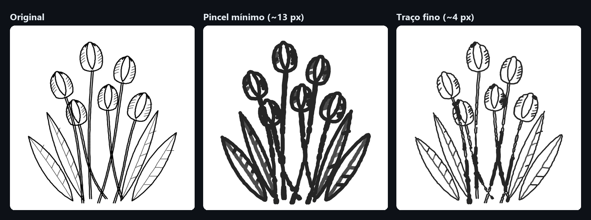
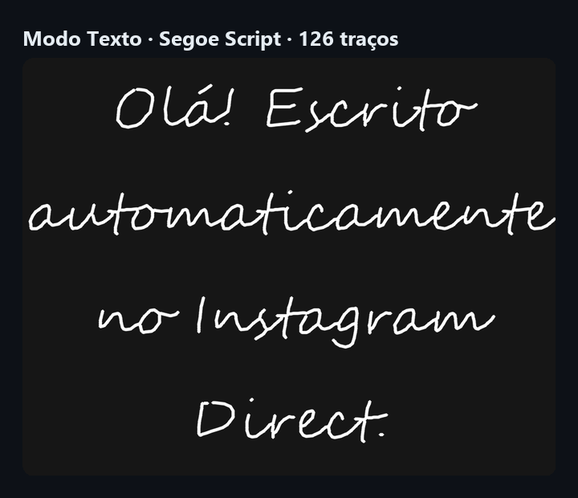
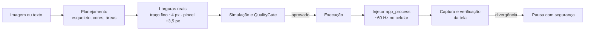

<div align="center">


# Instagram Painter Studio

**Transforma imagens e textos em traços e os desenha, gesto por gesto, no canvas de desenho do Instagram Direct pelo seu celular Android.**

[](https://www.python.org/)
[](#-requisitos)
[](#-testes)
[](LICENSE)

[Recursos](#-recursos) · [Galeria](#%EF%B8%8F-galeria) · [Instalação](#-instalação) · [Como usar](#-como-usar) · [Como funciona](#%EF%B8%8F-como-funciona) · [MCP](#-servidor-mcp-para-agentes-de-ia) · [Limitações](#-limitações-conhecidas)



</div>

> [!WARNING]
> Projeto independente e experimental, **sem afiliação com a Meta**. "Instagram" é marca registrada da Meta Platforms, Inc. Automatizar o aplicativo pode violar os [Termos de Uso do Instagram](https://help.instagram.com/581066165581870). Use por sua conta e risco, só no seu aparelho e na sua conta, e nunca para spam. Veja o [aviso legal](#%EF%B8%8F-aviso-legal).

---

## ✨ Recursos

| | |
|---|---|
| 🎨 **Quatro estilos de desenho** | Traçado colorido (line art), Livro de colorir, Ilustração chapada (fotos) e um modo **Automático** que escolhe pelo tipo de imagem. |
| ✍️ **Modo Texto** | Escreve qualquer texto com qualquer fonte TTF/OTF do Windows, no maior tamanho que cabe na área, com quebra de linha automática. |
| 🖊️ **Traço fino de ~4 px** | Usa uma posição do slider abaixo do trilho visível do Instagram, alcançada automaticamente. Linhas finas e detalhes deixam de virar borrões. |
| 👁️ **Prévia fiel** | Simula cada camada com a largura **medida no aparelho**, não a nominal. O que você vê na prévia é o que o celular desenha. |
| 🛡️ **Fail-closed** | Nada é desenhado sem a tela de desenho confirmada por captura, sem plano aprovado pelo *QualityGate* ou fora da área segura. Há botão de parada imediata. |
| ⚡ **Injetor residente** | Toques contínuos via `app_process` no ritmo de quadros do Instagram (~60 Hz), cerca de 9× mais rápido que `input swipe`. |
| ✏️ **Editor de prévia** | Selecione partes do desenho e troque a cor pela tinta real mais próxima. Tem desfazer/refazer e projetos salvos em `.npz`. |
| 🤖 **Servidor MCP** | 13 ferramentas JSON-RPC para agentes de IA planejarem, pré-visualizarem e executarem desenhos. |

---

## 🖼️ Galeria

Prévias geradas pelo programa a partir das imagens de exemplo de [`inputs/`](inputs), todas desenhadas por código.

<p align="center">
  <br>
  <br>
  
</p>

### Traço fino × pincel mínimo

O menor pincel alcançável arrastando o slider desenha ~13 px. Selecionando a caneta neon no mínimo e voltando para a sólida, a bolinha da sólida desce abaixo do trilho e o traço passa a ter ~4 px. O programa faz isso sozinho e pinta as camadas finas por último, para trocar de pincel uma vez só.

<p align="center"></p>

### Modo Texto

<p align="center"></p>

---

## 📋 Requisitos

- **Python 3.10+**, testado de 3.10 a 3.13.
- **Android Platform Tools (`adb`)**. Não precisa estar no `PATH`: o programa procura em `%LOCALAPPDATA%\Android\Sdk\platform-tools`, no `PATH` e em `C:\Android\platform-tools` / `C:\platform-tools`.
- **Celular Android** com *Depuração USB* ou *Depuração sem fio* ativada.
- **Windows** para a interface gráfica. O motor de planejamento e os testes são multiplataforma.

> [!NOTE]
> As coordenadas da interface do Instagram, a paleta de cores e as larguras de pincel foram calibradas num **Samsung Galaxy A73 (1080×2400)** com o Instagram 451. Outros aparelhos precisam de um perfil próprio em [`profiles/`](profiles).

---

## 🚀 Instalação

```bash
git clone https://github.com/coelhobugado/instagram-painter-studio.git
cd instagram-painter-studio
pip install -e .            # ou: pip install -r requirements.txt
```

Para rodar os testes, instale também `pip install -r requirements-dev.txt`.

---

## 🎯 Como usar

```bash
python main.py
```

1. **Imagem**: escolha um arquivo ou um exemplo (Flores, Retrato). O modo Texto não usa imagem.
2. **Estilo**: Automático, Traçado colorido, Livro de colorir, Ilustração chapada ou **Texto**.
3. **Celular**: conecte por USB ou Wi-Fi (`IP:porta` da depuração sem fio).
4. **Área de pintura** (opcional): marque sobre o print do celular onde desenhar.
5. **Gerar prévia**: confira o resultado, o tempo estimado e a aba *Qualidade*.
6. No celular, abra uma conversa e toque em **+ → Desenhar**. Depois, clique em **Iniciar pintura**.

> [!TIP]
> Durante a pintura, ative o **Não perturbe**. Uma notificação no topo da tela pode cobrir a barra de canetas e interromper o desenho. Nesse caso o programa para com segurança.

### Modo Texto

Digite o texto e escolha a fonte, o alinhamento, a cor e o **traço**:

- **Fino (caneta)** (padrão): ~4 px, como escrever à mão.
- **Seguir a espessura da fonte**: a largura do pincel acompanha a haste da letra, o que reproduz fontes em negrito.

Se o texto só couber com letras pequenas demais para ficarem legíveis, a prévia é recusada com uma mensagem, em vez de sair ilegível.

### Configuração por variáveis de ambiente

| Variável | Padrão | Efeito |
|---|---|---|
| `IGP_DEVICE_TARGET` | *(vazio)* | Aparelho do ADB (`serial` ou `IP:porta`). Vazio: usa o único aparelho autorizado. |
| `IGP_DEVICE_PROFILE` | `SM-A736B` | Pasta de perfil em `profiles/`. |
| `IGP_FINE_LINES` | `1` | `0` desliga o traço fino nos desenhos e volta ao pincel mínimo do trilho. |
| `IGP_TOUCH_TRANSPORT` | `injector` | `shell` força `input swipe` em vez do injetor residente. |

---

## ⚙️ Como funciona



- **Linhas**: o centro de cada linha (esqueleto Zhang-Suen) vira um traço contínuo. Cada trecho recebe a largura de pincel cuja espessura **real** fica mais perto da original.
- **Áreas**: preenchidas com anéis concêntricos, do pincel mais largo ao mais fino, que acompanham a forma sem varredura.
- **Cores**: escolhidas numa tabela medida no aparelho, com as 3 páginas da paleta e o seletor de nuances por toque longo, comparando em espaço Lab.
- **Texto**: diagramado em pixels da tela, vetorizado por letra com supersampling. Remove ramos falsos, trechos repetidos e quinas que o Instagram arredondaria.
- **Execução**: gestos `DOWN → MOVE… → UP` reamostrados por curvatura (passos de 10 a 24 px por quadro). Antes de cada camada o programa confere ferramenta, cor e espessura na tela.

---

## 🤖 Servidor MCP para agentes de IA

```bash
python -m studio.mcp.server      # stdio JSON-RPC
```

| Ferramenta | Função |
|---|---|
| `ig_device_status` | Conexão, tela e estado do Instagram |
| `ig_verify_canvas_safety` | Valida que a tela de desenho está aberta e segura |
| `ig_plan_artwork` | Planeja uma imagem (auto, line art, stencil, camadas) |
| `ig_plan_text` | Planeja um texto com fonte, traço fino ou espessura da fonte |
| `ig_preview_layer` | Prévia simulada de uma camada ou acumulada |
| `ig_execute_layer` | Executa uma camada com verificação |
| `ig_execute_freehand_path` | Desenha um caminho livre |
| `ig_select_tool` · `ig_set_thickness` · `ig_select_color` · `ig_action_undo` | Controles do canvas |
| `ig_capture_screen_diff` | Diferença visual da tela |
| `ig_emergency_kill` | Parada imediata |

---

## 🧪 Testes

```bash
python -m unittest discover -s tests -p "test_*.py"
```

São 381 testes que rodam **sem celular**. Eles cobrem planejamento, simulação, QualityGate, segurança fail-closed, interface, MCP e execução de ponta a ponta contra um `FakeADB` que desenha num canvas virtual com as mesmas larguras da prévia.

---

## 🗂️ Estrutura

```text
studio/
├── app_gui.py, gui/        Interface (CustomTkinter)
├── painter_engine.py       Entrada dos estilos e enriquecimento do plano
├── planning/               Line art, áreas, ilustração chapada, texto, ordem de traços
├── vision/                 Cor perceptual, saliência, feições
├── simulation/             Simulador calibrado do pincel
├── device/                 Perfis, larguras medidas, injetor, QualityGate, FakeADB
├── adb_manager.py          Conexão, slider, paleta, envio de gestos
├── execution_worker.py     Execução por camadas com checkpoints
└── mcp/                    Servidor MCP
profiles/SM-A736B/          Calibração do aparelho (UI, pincéis, cores)
scripts/                    Utilitários (gerar imagens de exemplo, LUT de cores…)
tests/                      Suíte automatizada
```

---

## 🧩 Limitações conhecidas

- **Um aparelho calibrado.** Outros celulares ou versões do Instagram exigem novo perfil de coordenadas, paleta e larguras.
- **Comportamento não documentado.** O traço fino depende de um efeito da interface do Instagram. Se ele deixar de existir, a pintura segue com o pincel mínimo e avisa no log.
- **Largura conforme a velocidade.** O Instagram desenha mais fino quando o gesto é rápido e mais grosso quando é lento. A prévia usa médias medidas.
- **Cor de linhas muito finas.** Linhas pretas antisserrilhadas podem ser lidas como cinza.
- **Fotos.** A Ilustração chapada simplifica a imagem em poucas cores planas, então retratos perdem detalhes finos.

---

## 🤝 Contribuindo

Contribuições são bem-vindas, principalmente **perfis de outros aparelhos** e melhorias de qualidade visual.

1. Abra uma *issue* descrevendo a mudança.
2. Rode a suíte de testes antes do *pull request*.
3. Mudanças de comportamento no celular devem vir com medição: print antes e depois e o valor medido.

As imagens de `inputs/` são recriadas com `python scripts/generate_sample_images.py`.

---

## ⚖️ Aviso legal

Este é um projeto independente, sem afiliação, patrocínio ou endosso da Meta Platforms, Inc. "Instagram" é marca registrada da Meta e aparece aqui apenas para descrever com qual aplicativo o programa funciona.

O programa simula toques na tela do **seu próprio** celular via ADB. Automatizar interações com o aplicativo pode violar os [Termos de Uso do Instagram](https://help.instagram.com/581066165581870) e levar a restrições na conta. Use por sua conta e risco, só no seu aparelho e na sua conta, e não use para spam nem para enviar conteúdo sem o consentimento de quem recebe.

## 📄 Licença

Distribuído sob a licença [MIT](LICENSE). O software é fornecido "como está", sem garantias.
